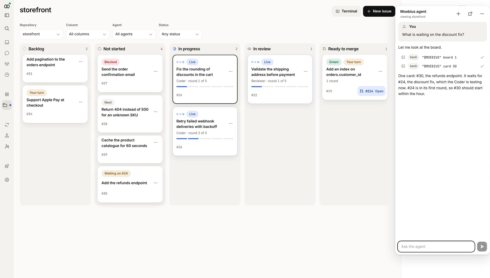
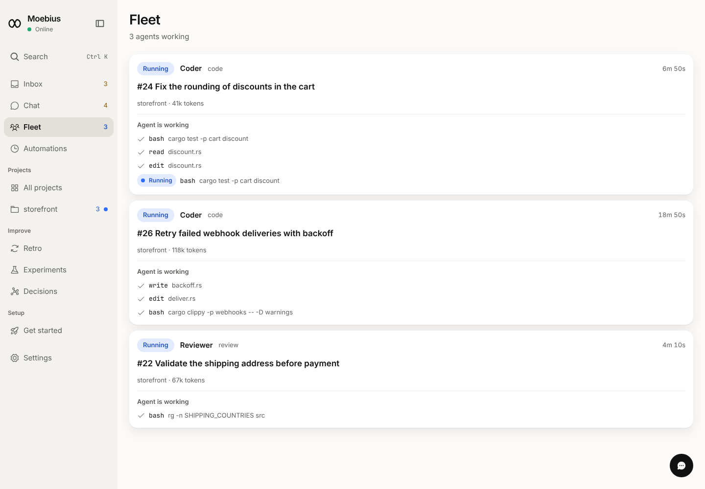
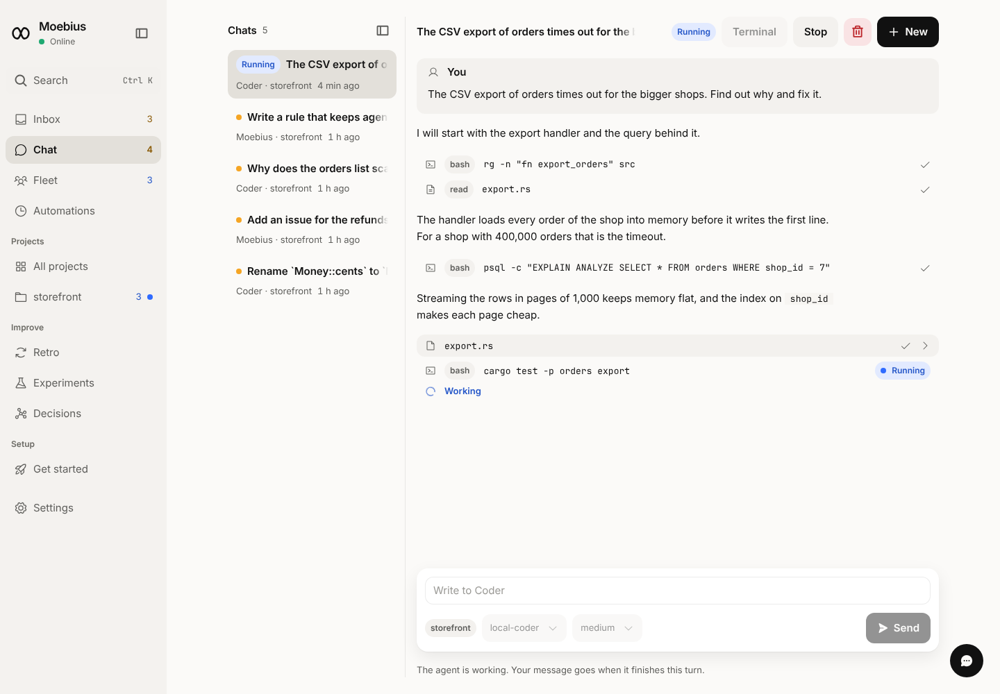
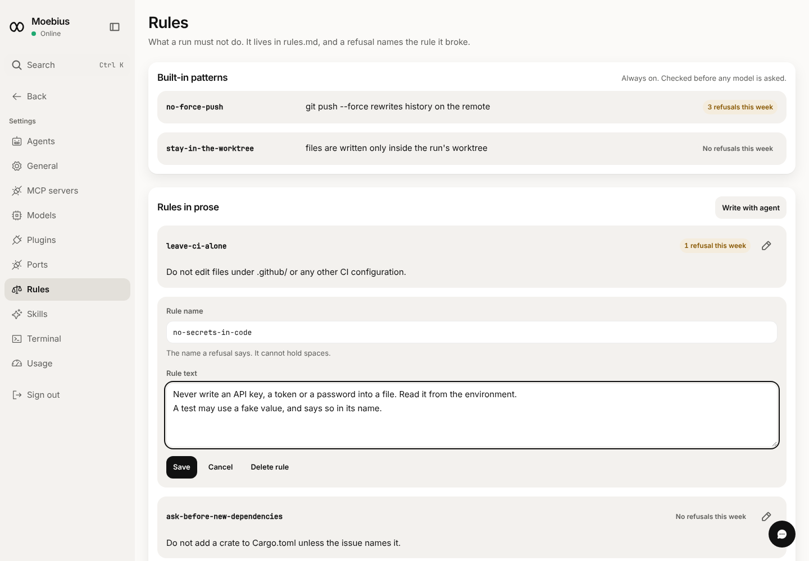
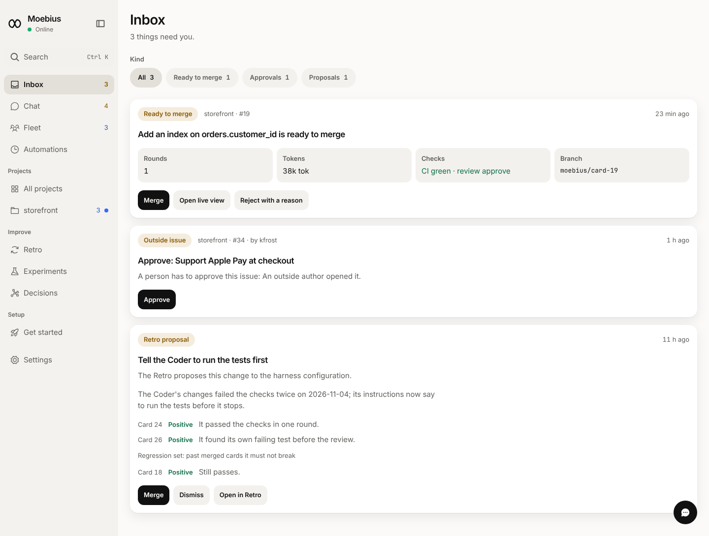

<div align="center">

# ∞ Moebius

**Issues in, changes ready to merge out.**

Moebius drives coding agents from a repository's issues to reviewed, tested changes, checks every step they take
against your rules, and learns from what went wrong.

[](https://github.com/Code000-211/Moebius/actions/workflows/ci.yml)


[](LICENSE)


</div>

> [!WARNING]
> Moebius is an early prototype. It is not ready for real projects: try it on a throwaway repository and tell us what
> you think. Things will change and break.

<picture>
  <source media="(prefers-color-scheme: dark)" srcset="docs/assets/screenshots/hero-dark.png">
  
</picture>

## What it does

You put issues on a board. Moebius picks them up and runs the workflow on its own:

1. **Code.** An agent works on the card in its own git worktree, through [Pi-Bolt](https://github.com/opensec-git/Pi-Bolt)
   or Claude Code, on the server or on another machine over SSH. A repository can ask for a failing reproduction test
   first.
2. **Check.** Every tool call the agent makes is checked against built-in patterns and the rules you write in plain
   prose, before it runs. A call that breaks a rule is refused, with the rule's name.
3. **Review.** The change is tested and reviewed on two axes, the repository's standards and what the issue asked
   for, and goes back to coding while a finding with evidence says something is wrong.
4. **Merge.** It waits in your inbox, as a branch, a GitHub or Forgejo pull request or a GitLab merge request, until you
   merge it.
5. **Improve.** Every night the Retro reads the day's failed runs and tries out fixes on their cards and on a set of
   past cards they must not break. Those that worked wait in the inbox for you.

Every decision on the way is recorded in full. Export them as a training set, plug in a small model of your own, and
Moebius lets it decide alongside the teacher model until it agrees often enough to take a kind of decision over.

## Features

| | |
|---|---|
| 🗂 **Projects** | A Kanban board per repository, plus a file browser and a code editor. A column's behaviour is a Luau script you can open and edit from the board. A menu on every card blocks it, unblocks it or deletes it. |
| 💬 **The Moebius agent, everywhere** | A floating chat on every page that knows what you are looking at: the file and line in the editor, the script or rule you are editing. Ask it to write an issue, a rule, an agent's instructions or a whole workflow. |
| 🛰 **Fleet** | Every working agent at a glance, live. |
| 🤖 **Coder and Reviewer** | Two built-in agents, each with its own instructions. Make a new agent blank or as a copy of any existing one, settings, skills and extensions included. |
| ⌨️ **Chat or terminal** | Chat with any agent, or switch the same conversation into Pi-Bolt's own terminal interface. |
| 🔁 **The Retro** | Reads the day's failed runs every night, and can be asked to try a failed day again. |
| ⏰ **Automations** | Recurring work on a cron schedule: an agent, a prompt and a place, with "Run now" and the history of every run. |
| 🧩 **Harnesses and runners** | Pi-Bolt or Claude Code per agent; runs on the server or on another machine over SSH, such as a GPU box. |
| 🌐 **Forges** | GitHub, GitLab (also self-hosted), Forgejo and Codeberg, or plain git without a forge. |
| 🛡 **Rules** | Built-in patterns plus rules in prose, checked on every tool call by a teacher model; per repository too. MCP tools go through one gateway and are checked the same way. |
| 🎯 **Better output** | What the research supports: a failing test before the fix, review on two axes with evidence, old tool outputs hidden and long ones cut, and Matt Pocock's engineering skills for the built-in agents. |
| ✏️ **Edit in place** | Agents, skills, MCP servers, rules, scripts, settings, cards: a pencil on everything, saved as a commit or in the store. |
| 🔌 **Your models** | Local OpenAI- or Anthropic-compatible servers, provider API keys or OAuth logins, behind one router that counts tokens, keeps budgets and falls back within a model class such as `strong`. |
| 🧱 **Plugins** | Deciders compiled in, or as their own program in any language, speaking JSON Lines. A launcher plugin wraps how a run starts: [`nono-sandbox`](https://github.com/Code000-211/moebius-plugins) runs every Pi-Bolt process in a sandbox. |
| 📦 **Packages** | Find, install, update and remove plugins, workflows, rules and skills from registries, and Pi packages from pi.dev, on the Plugins page and in an agent's Extensions. Changes to your configuration wait in the inbox. |
| 🔬 **Autoresearch** | Experiments against a baseline, with a budget of experiments or of tokens. |
| 🧰 **A command line** | Everything the web app does, as `moebius` commands, for scripts and for the agent itself. |

<table>
<tr>
<td>
<picture>
<source media="(prefers-color-scheme: dark)" srcset="docs/assets/screenshots/fleet-dark.png">

</picture>
</td>
<td>
<picture>
<source media="(prefers-color-scheme: dark)" srcset="docs/assets/screenshots/chat-dark.png">

</picture>
</td>
</tr>
<tr>
<td>
<picture>
<source media="(prefers-color-scheme: dark)" srcset="docs/assets/screenshots/rules-dark.png">

</picture>
</td>
<td>
<picture>
<source media="(prefers-color-scheme: dark)" srcset="docs/assets/screenshots/inbox-dark.png">

</picture>
</td>
</tr>
</table>

## How it fits together

```
web app (browser) ──(private network, sign-in)──▶ moebius server ──▶ GitHub, GitLab, Forgejo or plain git (polled)
                                              │
                                              ├──▶ Pi-Bolt or Claude Code runs, one worktree each,
                                              │    on the server or over SSH on another machine
                                              │      └─ every tool call and MCP call is checked before it runs
                                              └──▶ model router ──▶ local models / provider APIs
```

One headless server holds the boards, runs the column scripts, starts the agents and keeps everything in SQLite. The
web app it serves (React, in any browser; `moebius open` shows it in a window of its own, `moebius connect <host>` over SSH) talks to it over a documented API, and so does the `moebius` command line.
The web app is the only front end ([ADR 0017](docs/adr/0017-the-desktop-app-is-removed.md)).
[`docs/architecture.md`](docs/architecture.md) follows a card through the system.

## Quick start

You need Linux (on Windows, WSL 2 for the server), git, [Pi-Bolt](https://github.com/opensec-git/Pi-Bolt) installed as
`pi-bolt`, and a model: a local OpenAI-compatible server (such as one on `http://127.0.0.1:8080`) or a provider API key.
The `moebius` commands also run on Windows itself; the
[Windows section of Running Moebius](docs/guide/running-moebius.md#on-windows) shows how.

**1. Install.** From a [release](https://github.com/Code000-211/Moebius/releases) (Linux x86_64, and
`moebius-windows-x86_64.zip` with the commands for Windows; the page
[Running Moebius](docs/guide/running-moebius.md) shows how to check the download), or from source with Rust 1.90 or
newer:

```sh
cargo build --release
export PATH="$PWD/target/release:$PATH"
```

**2. Configure.** In a directory of its own:

```sh
mkdir -p ~/.config/moebius && cd ~/.config/moebius
moebius init      # writes moebius.toml, a commented file with every default, and harness/
```

`moebius init` also makes `harness/`, the [harness configuration repository](docs/reference/harness-configuration.md):
a git repository for your agents, skills, MCP servers and rules, where every edit in the app is a commit. Set an
upstream and the Pi-Bolt program in `moebius.toml` ([every key](docs/reference/configuration.md)); `init` already set
the program if it found `pi-bolt` on the `PATH`:

```toml
[[router.upstreams]]
protocol = "openai"
base_url = "http://127.0.0.1:8080"

[pi_bolt]
program = "/usr/local/bin/pi-bolt"
```

For repositories on GitHub, add a personal access token (`[github] token_file`, or `token_secret` for a stored secret);
[Running Moebius](docs/guide/running-moebius.md) lists the permissions it needs, and GitLab and Forgejo take a token the
same way.

**3. Run.**

```sh
moebius serve     # creates .moebius/ next to the file, with the API token in .moebius/token
```

**4. Open the web app.** `moebius open` shows it in a window of its own (a Chromium-based browser in app mode, signed
in once with a code; the default browser if there is none). For a server on another machine, `moebius connect <host>`
sets one up there if none runs (after asking), forwards its port over SSH and opens the window on it. Or open the server's address, `http://127.0.0.1:7171`, in any
browser and sign in with the content of `.moebius/token`. The **Get started** page lists what is still missing.

**5. Try it.** Give the Coder agent a model (on the Agents page, or below), add a project (a path that does not
exist yet becomes a new, empty repository) and create an issue:

```sh
moebius agent save Coder --model my-local-model
moebius repo add demo ~/moebius-demo
moebius issue create 1 "Add a greeting" --body "Add hello.txt that says hello."
moebius board
```

The card moves from Backlog to Not started to In progress, and ends in Ready to merge with a change waiting in the inbox.

> The server listens on plain HTTP and anyone with the token has full control. Keep it on `127.0.0.1` or a private
> network, never on the internet.

## Build on it

Moebius is made to be extended by people and agents who have not read its code. Every contract is documented exactly
in [`docs/reference/`](docs/reference/), and the [guide](docs/guide/README.md) shows each task step by step, with
examples that the tests run.

- **[Column scripts](docs/guide/column-scripts.md)** and **[workflows](docs/guide/workflows.md)**: change how cards move, in Luau, per repository.
- **[Rules](docs/guide/rules.md)**: what agents must never do, in prose.
- **[Agents](docs/guide/agents.md)**: models, instructions, skills, MCP servers and extensions.
- **[Pi extensions](docs/guide/extensions.md)**: TypeScript inside the agent's process.
- **[Plugins](docs/guide/plugins.md)**: deciders in Rust.
- **[Command line](docs/guide/command-line.md)** and **[desktop API](docs/guide/desktop-api.md)**: script anything.

Or just ask the Moebius agent: it knows the guide and the reference, and builds these for you.

## Documentation

[`docs/README.md`](docs/README.md) maps all of it. The main pages:

| | |
|---|---|
| [`GLOSSARY.md`](GLOSSARY.md) | The words Moebius uses. |
| [`docs/spec.md`](docs/spec.md), [`docs/adr/`](docs/adr/) | What the first version does, and why it is shaped this way. |
| [`docs/architecture.md`](docs/architecture.md) | How a card moves and which module does what. |
| [`docs/reference/`](docs/reference/) | [Column scripts](docs/reference/column-scripts.md), [rules](docs/reference/rules.md), [configuration](docs/reference/configuration.md), [command line](docs/reference/cli.md), [desktop API](docs/reference/desktop-api.md), [router](docs/reference/router.md), [plugin API](docs/reference/plugin-api.md), [bridge protocol](docs/reference/bridge-protocol.md), [harness configuration](docs/reference/harness-configuration.md), [training export](docs/reference/training-export.md), [decision model](docs/reference/decision-model.md). |
| [`docs/guide/`](docs/guide/README.md) | How to build on Moebius, one task per page. |
| [`docs/design-web.md`](docs/design-web.md) | The standard the web app is built to. |
| [`examples/`](examples/README.md) | Examples that run in CI. |
| [`CONTRIBUTING.md`](CONTRIBUTING.md) | How to work on Moebius: where new code goes, the checks, the commits. |

## Development

```
crates/
  moebius-core/        the server: app, config, store, router at the top;
                       server/ repos/ board/ decide/ harness/ improve/
  moebius/             the moebius binary and its command line (cli/)
  moebius-plugin-api/  the plugin trait and its host
web/                   the web app: React, TypeScript, Tailwind (src/, e2e/)
docs/                  guide, reference, architecture, spec, decisions, plan
examples/              examples that run in CI
dist/                  the release packaging (the systemd unit and the packaging script)
```

Each crate's `README.md` gives its layout, and the [module map](docs/architecture.md#modules) gives every module.
Before every commit, run what CI runs:

```sh
cargo fmt --all
cargo clippy --workspace --all-targets -- -D warnings
cargo test --workspace
cargo run -p moebius-plugin-api --example allow_reads
cargo run -p moebius-plugin-api --example allow_reads_process
cargo run -p moebius-plugin-api --example wrap_launcher
cargo run -p moebius-plugin-api --example wrap_launcher_process
```

The end-to-end tests run only when `MOEBIUS_PI_BOLT` names a `pi-bolt` executable.

When you change `web/`, run its checks too, from `web/` (after `pnpm install`):

```sh
pnpm check   # tsc --noEmit and Biome
pnpm test    # Vitest
pnpm build   # into web/dist
pnpm e2e     # Playwright, against a fake server; needs the build and Chromium
```

The pictures of this README are made by `pnpm screenshots` (after `pnpm build`): it opens the web app against the fake
server of the end-to-end tests and writes `docs/assets/screenshots/`, each in the dark and the light theme. [`CONTRIBUTING.md`](CONTRIBUTING.md) says
how to work in the repository; [`CLAUDE.md`](CLAUDE.md) (also [`AGENTS.md`](AGENTS.md)) says the same for coding
agents.

## Feedback

Ideas, confusion, bugs: [open an issue](https://github.com/Code000-211/Moebius/issues). Everything helps at this stage.

## License

Moebius is licensed under the [Apache License, Version 2.0](LICENSE). Contributions are accepted under the same
license, as section 5 of the license says.
