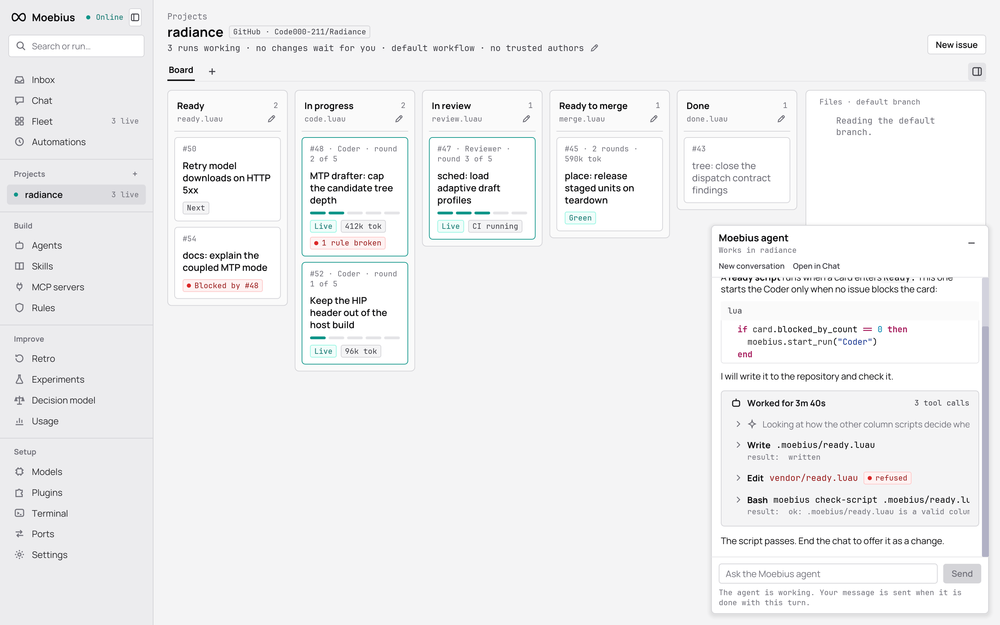
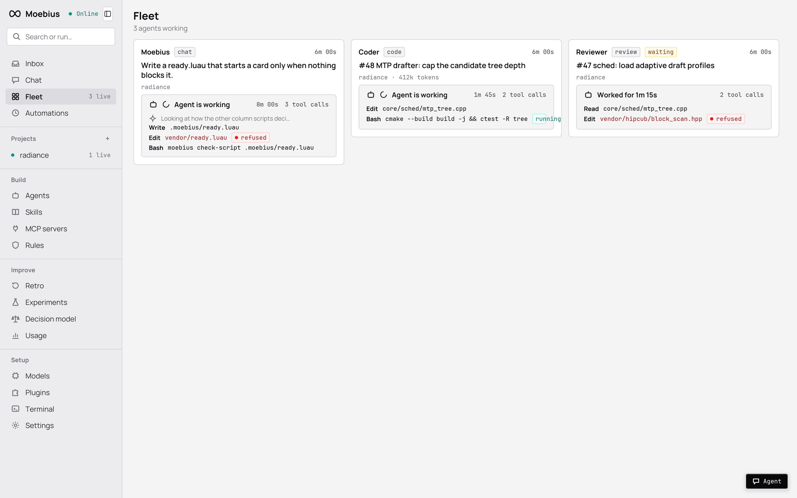
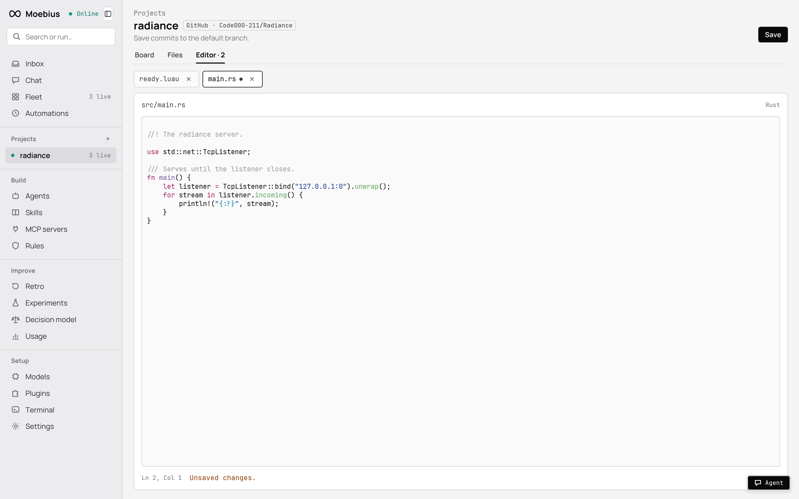
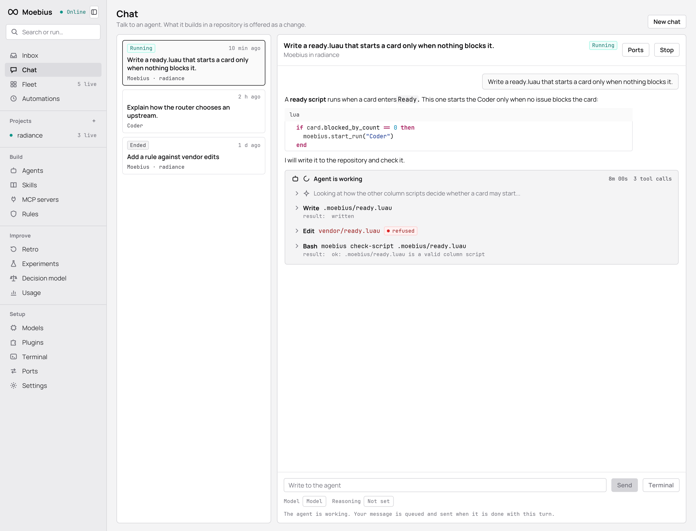
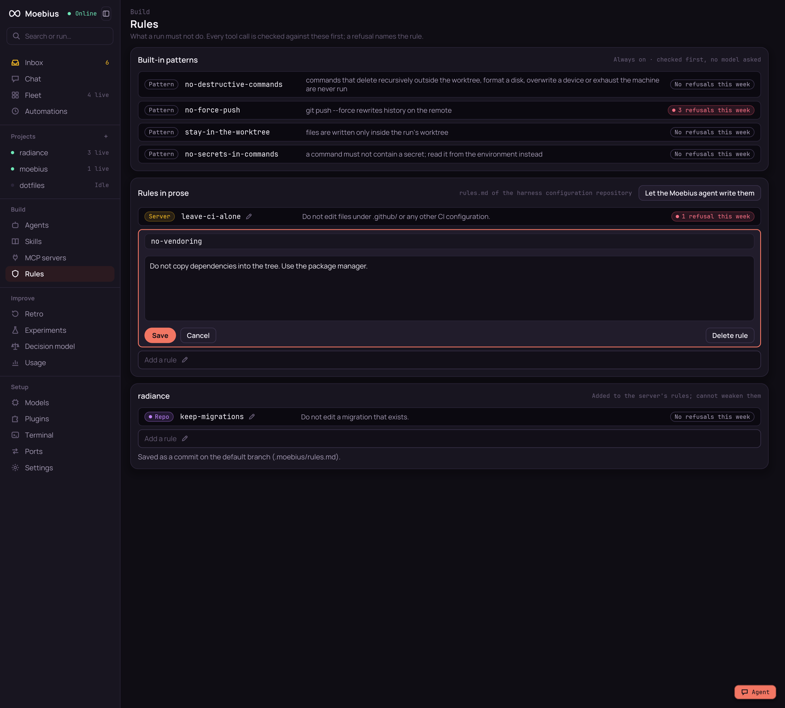

<div align="center">

# ∞ Moebius

**Issues in, changes ready to merge out.**

Moebius drives coding agents from a repository's issues to reviewed, tested changes, checks every step they take
against your rules, and learns from what went wrong.

[](https://github.com/Code000-211/Moebius/actions/workflows/ci.yml)


[](LICENSE)


</div>

> [!WARNING]
> Moebius is an early prototype. It is not ready for real projects: try it on a throwaway repository and tell us what
> you think. Things will change and break.



## What it does

You put issues on a board. Moebius picks them up and runs the workflow on its own:

1. **Code.** An agent works on the card in its own git worktree, through [Pi-Bolt](https://github.com/opensec-git/Pi-Bolt).
2. **Check.** Every tool call the agent makes is checked against built-in patterns and the rules you write in plain
   prose, before it runs. A call that breaks a rule is refused, with the rule's name.
3. **Review.** The change is tested and reviewed by another agent, and goes back to coding while something is wrong.
4. **Merge.** It waits in your inbox, as a branch, a GitHub pull request or a GitLab merge request, until you merge it.
5. **Improve.** Every night the Retro looks at what went wrong and tries out fixes. Those that worked wait in the inbox
   for you.

Every decision on the way is recorded in full. Export them as a training set, plug in a small model of your own, and
Moebius lets it decide alongside the teacher model until it agrees often enough to take a kind of decision over.

## Features

| | |
|---|---|
| 🗂 **Projects** | A Kanban board per repository, plus a file browser and a code editor. A column's behaviour is a Luau script you can open and edit from the board. |
| 💬 **The Moebius agent, everywhere** | A floating chat on every page that knows what you are looking at: the file and line in the editor, the script or rule you are editing. Ask it to write an issue, a rule, an agent's instructions or a whole workflow. |
| 🛰 **Fleet** | Every working agent at a glance, live. |
| ⌨️ **Chat or terminal** | Chat with any agent, or switch the same conversation into Pi-Bolt's own terminal interface. |
| 🛡 **Rules** | Built-in patterns plus rules in prose, checked on every tool call by a teacher model; per repository too. |
| ✏️ **Edit in place** | Agents, skills, MCP servers, rules, scripts, settings, cards: a pencil on everything, saved as a commit or in the store. |
| 🔌 **Your models** | Local OpenAI- or Anthropic-compatible servers or provider API keys, behind one router that counts tokens and keeps budgets. |
| 🧰 **A command line** | Everything the app does, as `moebius` commands, for scripts and for the agent itself. |

<table>
<tr>
<td></td>
<td></td>
</tr>
<tr>
<td></td>
<td></td>
</tr>
</table>

## How it fits together

```
desktop app ──(private network, token)──▶ moebius server ──▶ GitHub, GitLab or plain git (polled)
                                              │
                                              ├──▶ Pi-Bolt runs, one worktree each
                                              │      └─ every tool call is checked before it runs
                                              └──▶ model router ──▶ local models / provider APIs
```

One headless server holds the boards, runs the column scripts, starts the agents and keeps everything in SQLite. The
desktop app (Rust, [iced](https://iced.rs)) talks to it over a documented API, and so does the `moebius` command line.
[`docs/architecture.md`](docs/architecture.md) follows a card through the system.

## Quick start

You need Linux (on Windows, WSL 2 for the server), git, [Pi-Bolt](https://github.com/opensec-git/Pi-Bolt) installed as
`pi-bolt`, and a model: a local OpenAI-compatible server (such as one on `http://127.0.0.1:8080`) or a provider API key.
The desktop app and the `moebius` commands also run on Windows itself; the
[Windows section of Running Moebius](docs/guide/running-moebius.md#on-windows) shows how.

**1. Install.** From a [release](https://github.com/Code000-211/Moebius/releases) (Linux x86_64, and
`moebius-windows-x86_64.zip` with the app and the commands for Windows; the page
[Running Moebius](docs/guide/running-moebius.md) shows how to check the download), or from source with Rust 1.90 or
newer:

```sh
cargo build --release
export PATH="$PWD/target/release:$PATH"
```

**2. Configure.** In a directory of its own:

```sh
mkdir -p ~/.config/moebius && cd ~/.config/moebius
moebius init      # writes moebius.toml, a commented file with every default, and harness/
```

`moebius init` also makes `harness/`, the [harness configuration repository](docs/reference/harness-configuration.md):
a git repository for your agents, skills, MCP servers and rules, where every edit in the app is a commit. Set an
upstream and the Pi-Bolt program in `moebius.toml` ([every key](docs/reference/configuration.md)); `init` already set
the program if it found `pi-bolt` on the `PATH`:

```toml
[[router.upstreams]]
protocol = "openai"
base_url = "http://127.0.0.1:8080"

[pi_bolt]
program = "/usr/local/bin/pi-bolt"
```

**3. Run.**

```sh
moebius serve     # creates .moebius/ next to the file, with the API token in .moebius/token
```

**4. Connect the app.** Start the desktop app (from a release for Linux or Windows, or `cargo run -p moebius-desktop`;
on Windows it reaches a server in WSL at the same address), and give it the
address `http://127.0.0.1:7171` and the content of `.moebius/token`. The **Get started** page lists what is still
missing.

**5. Try it.** Give the Coder agent a model (on the Agents page, or below), add a project (a path that does not
exist yet becomes a new, empty repository) and create an issue:

```sh
moebius agent save Coder --model my-local-model
moebius repo add demo ~/moebius-demo
moebius issue create 1 "Add a greeting" --body "Add hello.txt that says hello."
moebius board
```

The card moves from Backlog to Ready to In progress, and ends in Ready to merge with a change waiting in the inbox.

> The server listens on plain HTTP and anyone with the token has full control. Keep it on `127.0.0.1` or a private
> network, never on the internet.

## Build on it

Moebius is made to be extended by people and agents who have not read its code. Every contract is documented exactly
in [`docs/reference/`](docs/reference/), and the [guide](docs/guide/README.md) shows each task step by step, with
examples that the tests run.

- **[Column scripts](docs/guide/column-scripts.md)** and **[workflows](docs/guide/workflows.md)**: change how cards move, in Luau, per repository.
- **[Rules](docs/guide/rules.md)**: what agents must never do, in prose.
- **[Agents](docs/guide/agents.md)**: models, instructions, skills, MCP servers and extensions.
- **[Pi extensions](docs/guide/extensions.md)**: TypeScript inside the agent's process.
- **[Plugins](docs/guide/plugins.md)**: deciders in Rust.
- **[Command line](docs/guide/command-line.md)** and **[desktop API](docs/guide/desktop-api.md)**: script anything.

Or just ask the Moebius agent: it knows the guide and the reference, and builds these for you.

## Documentation

[`docs/README.md`](docs/README.md) maps all of it. The main pages:

| | |
|---|---|
| [`GLOSSARY.md`](GLOSSARY.md) | The words Moebius uses. |
| [`docs/spec.md`](docs/spec.md), [`docs/adr/`](docs/adr/) | What the first version does, and why it is shaped this way. |
| [`docs/architecture.md`](docs/architecture.md) | How a card moves and which module does what. |
| [`docs/reference/`](docs/reference/) | [Column scripts](docs/reference/column-scripts.md), [rules](docs/reference/rules.md), [configuration](docs/reference/configuration.md), [command line](docs/reference/cli.md), [desktop API](docs/reference/desktop-api.md), [router](docs/reference/router.md), [plugin API](docs/reference/plugin-api.md), [bridge protocol](docs/reference/bridge-protocol.md), [harness configuration](docs/reference/harness-configuration.md), [training export](docs/reference/training-export.md), [decision model](docs/reference/decision-model.md). |
| [`docs/guide/`](docs/guide/README.md) | How to build on Moebius, one task per page. |
| [`docs/design.md`](docs/design.md) | The look of the desktop app. |
| [`examples/`](examples/README.md) | Examples that run in CI. |
| [`CONTRIBUTING.md`](CONTRIBUTING.md) | How to work on Moebius: where new code goes, the checks, the commits. |

## Development

```
crates/
  moebius-core/        the server: app, config, store, router at the top;
                       server/ repos/ board/ decide/ harness/ improve/
  moebius-desktop/     the desktop app: app/ client/ at the top; screens/ widgets/
  moebius/             the moebius binary and its command line (cli/)
  moebius-plugin-api/  the plugin trait and its host
docs/                  guide, reference, architecture, spec, decisions, plan
examples/              examples that run in CI
dist/                  the release packaging (systemd unit, desktop entry)
```

Each crate's `README.md` gives its layout, and the [module map](docs/architecture.md#modules) gives every module.
Before every commit, run what CI runs:

```sh
cargo fmt --all
cargo clippy --workspace --all-targets -- -D warnings
cargo test --workspace
cargo run -p moebius-plugin-api --example allow_reads
cargo run -p moebius-plugin-api --example allow_reads_process
```

The end-to-end tests run only when `MOEBIUS_PI_BOLT` names a `pi-bolt` executable. The desktop app's render tests
compare against the pictures in `crates/moebius-desktop/tests/snapshots/`. [`CONTRIBUTING.md`](CONTRIBUTING.md) says
how to work in the repository; [`CLAUDE.md`](CLAUDE.md) (also [`AGENTS.md`](AGENTS.md)) says the same for coding
agents.

## Feedback

Ideas, confusion, bugs: [open an issue](https://github.com/Code000-211/Moebius/issues). Everything helps at this stage.

## License

Moebius is licensed under the [Apache License, Version 2.0](LICENSE). Contributions are accepted under the same
license, as section 5 of the license says.
